# Directly write one zone! ZOA-PCNN-AT-SVM zebra optimization parallel convolution - support vector machine fusion attention mechanism fault identification program, directly run!

Applicable Platform: Matlab2023 version and above
This original program proposes the ZOA-PCNN-AT-SVM fault identification model, which has not been written before! On this basis, further multiple improvements have been made to the reference model. The program is well commented, full of valuable information, and a brief introduction to the article and the program is provided below!
①The recognition model part refers to the Chinese EI journal "Electric Power Automation Equipment"'s December 29th online first-published document: "Health Diagnosis of Switching Devices in Inverters Based on Gram Angle Field and Parallel CNN";
②The optimization model part refers to the renowned SCI journal "IEEE Access"'s October 2022 paper "Zebra Optimization Algorithm: A New Bio-Inspired Optimization Algorithm for Solving Optimization Algorithm", which was published in that month. This algorithm was introduced very recently and there are no existing literature applying this algorithm.
​
Original literature interpretation of the recognition model: In this paper, firstly, one-dimensional fault voltage and current signal sequences are collected; secondly, they are transformed by the Gram angle field, converting both one-dimensional time series signals into Gram angle field; finally, two sets of images generated are simultaneously fed into CNN for parallel learning and training, achieving fault diagnosis of inverter.
Zebra Optimization (ZOA) Introduction: The basic inspiration for Zebra Optimization comes from the behavior of zebras in nature. ZOA simulates the foraging behavior and defensive strategies of zebras against predator attacks, describing the steps of ZOA and then conducting mathematical modeling. The performance of ZOA in optimization is evaluated based on 68 benchmark functions, including unimodal, high-dimensional multimodal, and fixed-dimensional multimodal. The results obtained by ZOA are compared with the performance of nine well-known algorithms: GWO, TLBO, GA, MPA, PSO, QANA, TSA, WOA, and GSA. Simulation results show that ZOA can solve optimization problems by establishing an appropriate balance between exploration and exploitation, and it has superior performance compared to nine competitive algorithms. ZOA was tested on four real engineering problems.
Model Improvement: Based on the above literature models, we propose multiple improvements to our proposed model. The ZOA-PCNN-AT-SVM fault identification model: adopts a dual-branch structure, requires only raw fault waveform data, and can convert a one-dimensional sequence into a two-dimensional Gramian summed field image according to the waveform data. The image is simultaneously input into the PCNN-AT-SVM model, and ZOA is used to optimize the hyperparameters in the model. It provides two feature maps extracted from the dual branches, providing the distribution between the original samples and feature samples, enhancing the interpretability of the model. It also calculates evaluation indicators such as precision, recall, accuracy, F1 score, etc. The fault identification process is as follows:
Seven innovation points:
1. Time series visualization: Converting a one-dimensional time series signal into a two-dimensional image helps describe the characteristics of the data more comprehensively. This facilitates the extraction of richer and more distinctive features, thereby improving the accuracy of classification and recognition.
2. Spatial Feature Learning: Convolutional Neural Networks (CNN) perform exceptionally well in image processing, effectively learning spatial features and local patterns of images. Applying CNNs to the processing of image data can help extract texture, shape, and edge features of images, aiding in more accurate classification and fault identification.
3. Dual-Branch Structure: By utilizing two branches of CNNs to learn different image weights, the dual-branch high-dimensional features complement each other, significantly enhancing deep spatial features.
4. Multi-Head Self-Attention Mechanism: Integrating a multi-head attention mechanism effectively grasps the contribution of extracted features, focusing on strengthening key features to improve the accuracy of fault identification.
5. Interpretability: To enhance model interpretability, the t-SNE interpretability algorithm is applied to visualize the feature maps of each branch module; comparing the distribution of samples before and after extracting features with ZOA-PCNN-AT-SVM.
6. Improved Output Structure: The original Softmax layer is improved to an SVM. As a probability method, the Softmax is susceptible to outliers, while the SVM classifies samples within a certain distance based on the distribution of samples, demonstrating stronger robustness against outliers.
7. Superparameter Optimization: The Zebra Optimization Algorithm (ZOA) is used to optimize parameters in the model that are difficult to determine, such as the learning rate for the first branch convolution kernel size, and the second branch convolution kernel size. This ensures a more rational structure of the model and improves fault identification accuracy.
Applicable Fields: Suitable for various data classification scenarios, such as rolling bearing faults, transformer oil gas faults, power system transmission line fault areas, insulators, substations, and disturbances in electric energy quality, etc., for recognition, diagnosis, and classification.
Hands-on analysis guide:
Data format: Each sample (representing a waveform) is represented by one row in the dataset, and the last column directly replaces the fault type label. Data can be directly imported into the program using an Excel spreadsheet without significant modifications to the program. The program includes detailed comments for ease of understanding the program's operation.
\n        \n      Results of the program: (Automatically converted from the above one-dimensional sequence into a Gram Matrix image)  
\n        \n      Model structure:  
\n        \n      PCNN implementation of feature visualization with dual branches (demonstrating that features of two branches are different and complementary)  
\n        \n      Compare to original samples, ZOA-PCNN-SVM can achieve clustering of similar samples, achieving aggregation of fault samples of the same category (differentiation between categories, aggregation within categories)  
\n        \n      Model training curve:  
\n        \n      Training curve: and Zebra Optimization ZOA fitness curve:

## Images

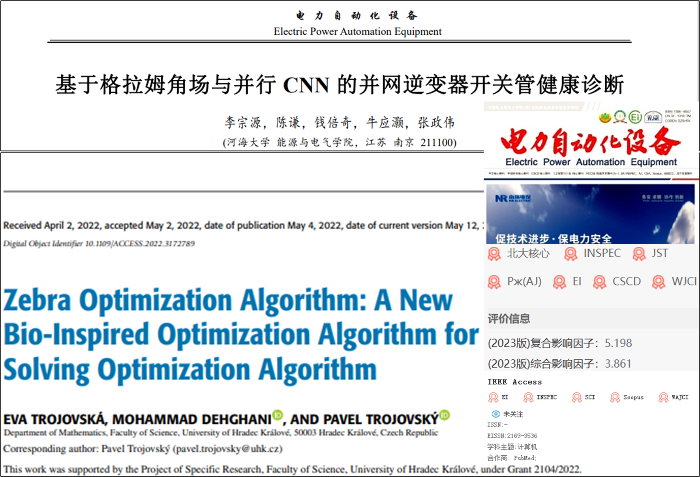

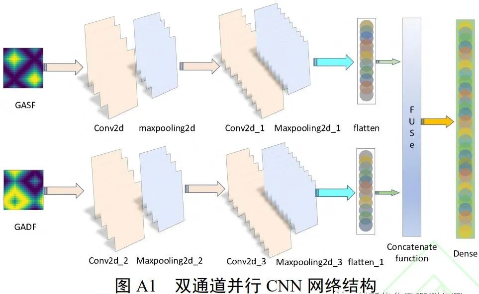
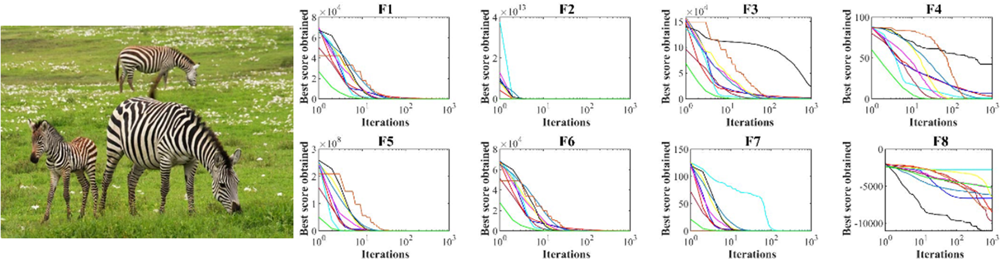
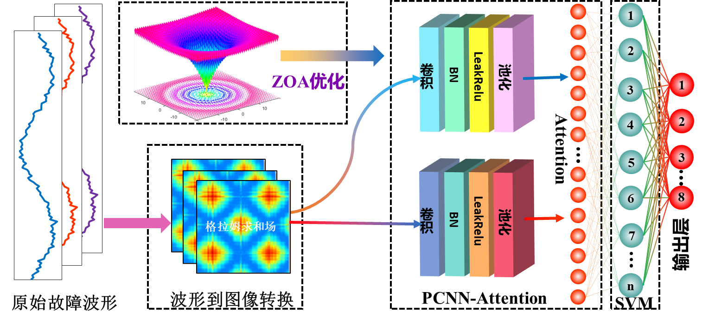
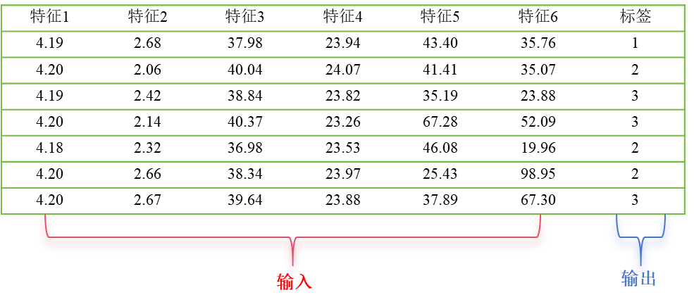
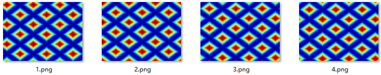
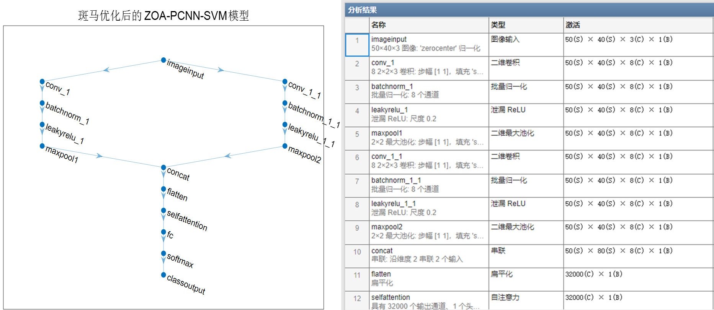
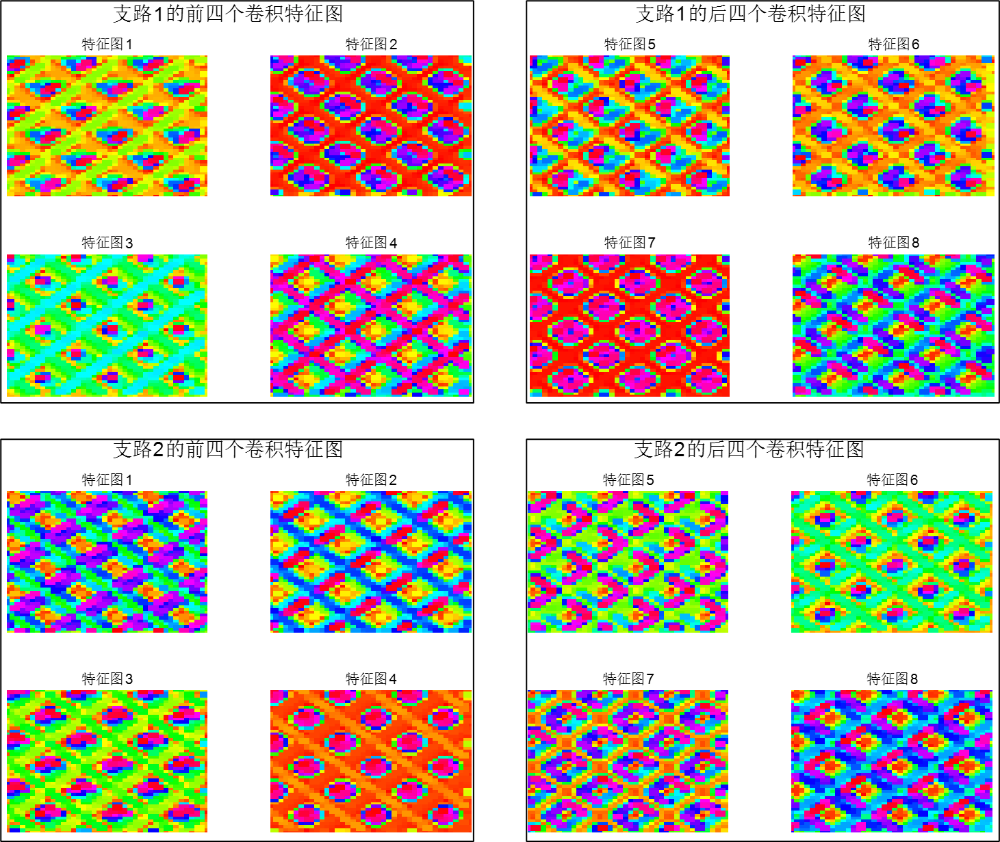
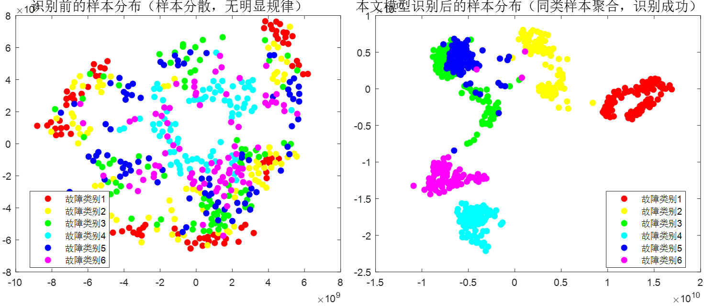
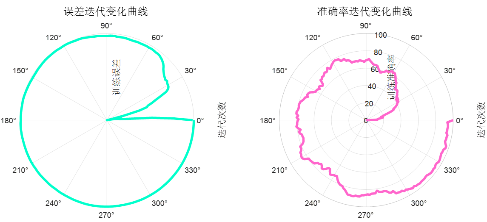
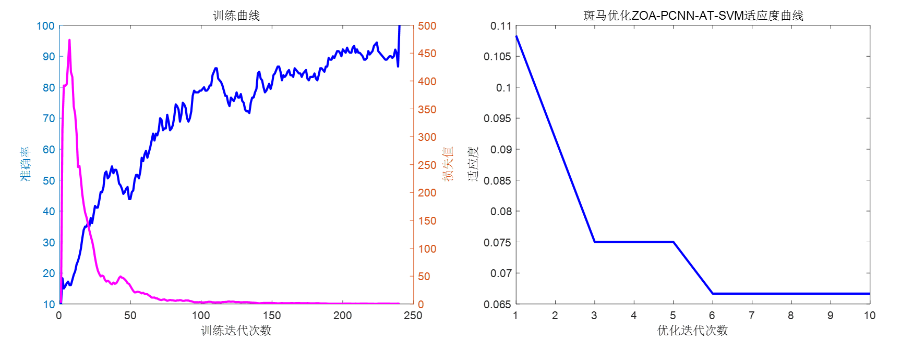

<!-- PAYMENT_BLOCK -->

## Get this dataset

- Payment link (Stripe): [Buy now](https://buy.stripe.com/3cs8yP7sY87d0vu9AB)
- Payment QR code: 

<!-- /PAYMENT_BLOCK -->
